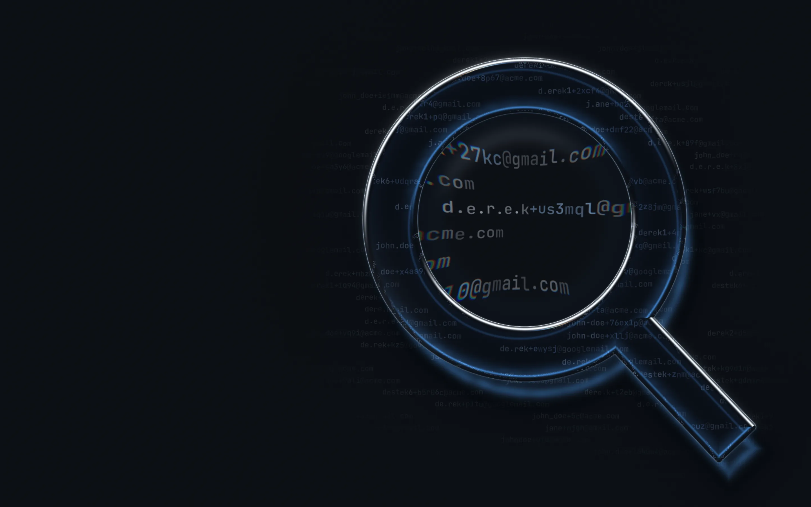

<!-- markdownlint-disable first-line-h1 -->

<section class="cover-hero" data-cover data-mode="loading" aria-labelledby="cover-title">
    <picture class="cover__still" aria-hidden="true">
      <source media="(max-width: 759px) and (prefers-color-scheme: light)" srcset="docs/cover/fallback-light-mobile.webp">
      <source media="(max-width: 759px)" srcset="docs/cover/fallback-dark-mobile.webp">
      <source media="(prefers-color-scheme: light)" srcset="docs/cover/fallback-light.webp">
      
    </picture>
    <canvas class="cover__scene" aria-hidden="true"></canvas>
    

      

        
        abusive
      

      
Catch the same person signing&nbsp;up&nbsp;twice.

      

        

          <button type="button" class="cover__copy-prompt" data-copy-prompt data-prompt="Wire abusive into this project's signup: run npm install abusive free-email-domains, create one instance with require('abusive')({ rejectedDomains: require('free-email-domains'), sibling: { lookup }, ip: { store }, secret: process.env.ABUSIVE_SECRET }) where lookup is stripeLookup from abusive/stripe or a function returning the registered emails at a domain and store is redisStore from abusive/redis with timeoutMs set, refuse the signup with a neutral message when await isAbusive({ email }) is true, check again with await isAbusive({ email, ip, verified: true }) once the address is verified, and apply isRejectedEmail only if this project refuses free email providers."><svg viewBox="0 0 24 24" width="16" height="16" aria-hidden="true"><rect x="8" y="8" width="12" height="12" rx="2.5"/><path d="M16 8V6.5A2.5 2.5 0 0 0 13.5 4h-7A2.5 2.5 0 0 0 4 6.5v7A2.5 2.5 0 0 0 6.5 16H8"/></svg>Copy prompt</button>
        

        
        

          <code data-command>npm install abusive free-email-domains</code>
          <button type="button" class="cover__copy" data-copy aria-label="Copy command">
            <svg viewBox="0 0 24 24" width="16" height="16" aria-hidden="true"><rect x="8" y="8" width="12" height="12" rx="2.5"/><path d="M16 8V6.5A2.5 2.5 0 0 0 13.5 4h-7A2.5 2.5 0 0 0 4 6.5v7A2.5 2.5 0 0 0 6.5 16H8"/></svg>
          </button>
        

      

      <nav class="cover__links" aria-label="Get started">
        <a class="cover__link cover__link--primary" href="#/?id=quick-start">Get started &rarr;</a>
        <a class="cover__link" href="https://github.com/Kikobeats/abusive">
          <svg class="cover__mark" viewBox="0 0 16 16" width="16" height="16" aria-hidden="true"><path fill="currentColor" d="M8 0C3.58 0 0 3.58 0 8c0 3.54 2.29 6.53 5.47 7.59.4.07.55-.17.55-.38 0-.19-.01-.82-.01-1.49-2.01.37-2.53-.49-2.69-.94-.09-.23-.48-.94-.82-1.13-.28-.15-.68-.52-.01-.53.63-.01 1.08.58 1.23.82.72 1.21 1.87.87 2.33.66.07-.52.28-.87.51-1.07-1.78-.2-3.64-.89-3.64-3.95 0-.87.31-1.59.82-2.15-.08-.2-.36-1.02.08-2.12 0 0 .67-.21 2.2.82.64-.18 1.32-.27 2-.27.68 0 1.36.09 2 .27 1.53-1.04 2.2-.82 2.2-.82.44 1.1.16 1.92.08 2.12.51.56.82 1.27.82 2.15 0 3.07-1.87 3.75-3.65 3.95.29.25.54.73.54 1.48 0 1.07-.01 1.93-.01 2.2 0 .21.15.46.55.38A8.013 8.013 0 0 0 16 8c0-4.42-3.58-8-8-8Z"/></svg>
          GitHub
        </a>
      </nav>
    

    <a class="cover__scroll" href="#/?id=install" aria-label="Scroll to the documentation">
      <svg viewBox="0 0 24 24" width="22" height="22" aria-hidden="true"><path d="M6 9l6 6 6-6"/></svg>
    </a>
    <button type="button" class="cover__pause" data-pause aria-pressed="false" aria-label="Pause the animation">
      <svg viewBox="0 0 24 24" width="16" height="16" aria-hidden="true"><path class="cover__pause-icon" d="M7 5h3.5v14H7zM13.5 5H17v14h-3.5z"/><path class="cover__play-icon" d="M8 5.5v13l11-6.5z"/></svg>
    </button>
  </section>
